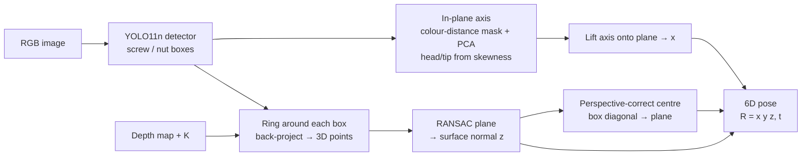
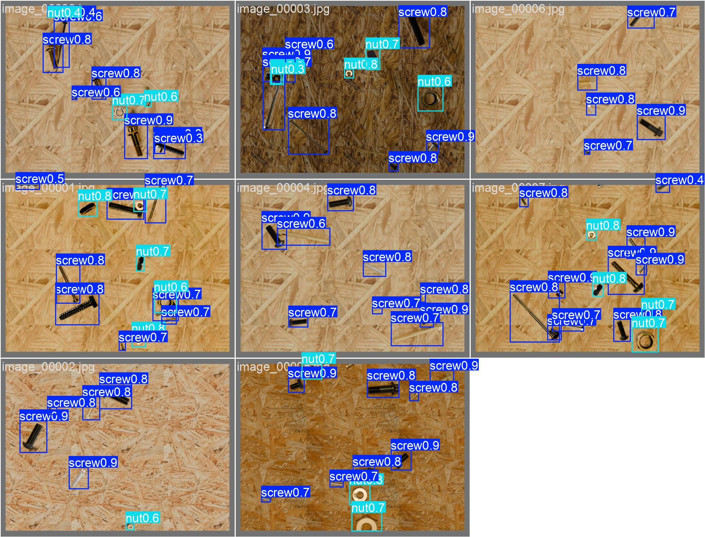
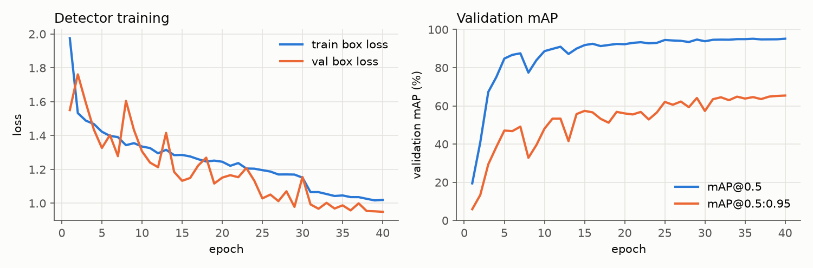
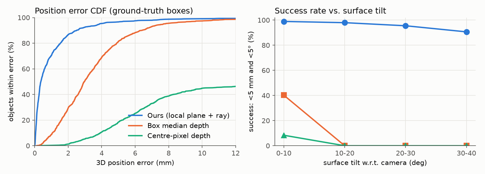
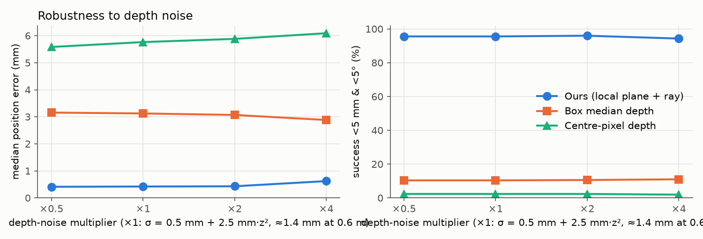
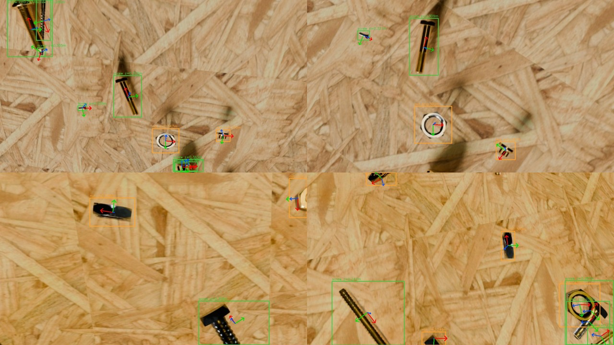

# screwpose — general screw detection & 6D pose from RGB-D

A model-free pipeline that **detects screws and nuts in an RGB image and lifts every detection to a full 6D pose
(position + orientation) using a registered depth map**. It does not rely on a CAD model, a fixed surface normal or a
scene-specific calibration, so it can be used for bin-picking, sorting or screwing tasks on any (piecewise) planar
work surface seen by a stereo/ToF camera.

| | |
|---|---|
| **Detector** | YOLO11n, trained from COCO weights on a public dataset (2 classes: `screw`, `nut`) |
| **6D lifting** | per-object RANSAC plane + ray/plane intersection + perspective-correct centre + in-plane screw axis |
| **Output** | position (m, camera frame), rotation matrix / quaternion, surface normal, head direction, quality flags |
| **Detection (test, 200 images)** | **mAP@0.5 = 0.948**, mAP@0.5:0.95 = 0.650, P = 0.961, R = 0.913 |
| **6D pose (346 RGB-D scenes, 953 objects)** | median position error **0.37 mm**, median normal error **0.07°**, **96.1 %** within 5 mm & 5° |

Everything below was produced end-to-end on a laptop CPU (Intel Core Ultra 7 155H, no GPU) with `./run_all.sh`.

---

## 1. Method



1. **Detection.** A YOLO11n detector finds screws/bolts (`screw`) and nuts/washers (`nut`).
2. **Surface normal.** Depth on shiny metal parts is usually missing or wrong, so depth is *not* read on the object.
   Instead, depth is sampled on a **ring around the box** (2.2× the box, box itself excluded), back-projected with the
   intrinsics, and a **local plane** is fitted with RANSAC (3 mm threshold) and refined by least squares. Its normal is
   the approach axis `z`. Every object gets its own plane, so tilted, multi-level and curved (locally planar) surfaces
   are handled.
3. **Position.** The 3D position is the intersection of the viewing ray with that plane — the contact point of the part
   on the surface — so holes in the depth map on the part do not matter. Under perspective the 2D box centre is not
   the image of the 3D centre; for elongated parts the two ends project onto opposite box corners, so the matching
   **box diagonal is back-projected onto the plane and its 3D midpoint is used** (`PoseEstimator._perspective_center`).
4. **In-plane orientation.** Within the box, the part is separated from the local background by colour distance (Lab,
   Otsu), and a PCA of the mask gives the long axis. The **head/tip direction** comes from the skewness along that axis
   (the head is the heavy end). The axis is lifted onto the plane to give `x`; `y = z × x`. Parts that are round
   (nuts, washers, screws seen head-on; elongation < 1.6) get `x` from the camera x-axis.

The detector is the only learned component; steps 2–4 are pure geometry (~19 ms per object in NumPy).

## 2. Data

**Detection: [UT57/synthetic_screws](https://huggingface.co/datasets/UT57/synthetic_screws)** (MIT licence) is a public
photorealistic dataset of screws, bolts, nuts and washers on wooden boards, made to look like MVTec Screws. Images are
downloaded and resized to 1280 px on the long side by `scripts/download_data.py`.

| split | images | `screw` | `nut` |
|---|---:|---:|---:|
| train | 800 | 5 693 | 2 201 |
| val | 160 | 1 080 | 498 |
| test | 200 | 1 448 | 568 |

**6D pose: a synthetic RGB-D benchmark with exact ground truth** (`scripts/make_rgbd_benchmark.py`). No public dataset
has screws with registered depth and 6D labels. So each held-out **test** image is used as the texture of a physical
work surface. The surface is placed in front of a virtual 1280×720 camera (fx = fy = 900 px) at 0.25–0.5 m, tilted
**uniformly in 0–40°** with random azimuth and in-plane rotation, and the camera sees it in perspective. The depth
map includes the effects that make real screw depth hard:

- **object relief**: every labelled part sticks out of the surface by 2–8 mm;
- **specular dropout**: 30–70 % of the pixels on each part are missing;
- **stereo-like noise**: σ(z) = 0.5 mm + 2.5 mm·z² (≈1.4 mm at 0.6 m), spatially correlated;
- **random holes**: about 5 % of the map, in blobs.

Ground truth per object: contact point (box centre on the surface), surface normal, projected box and class.
2 views × 200 test images → **346 scenes / 953 objects** (views where no object is fully visible are dropped).

## 3. Results

### 3.1 Detection (UT57 test split, 200 images, imgsz 640)

| class | precision | recall | mAP@0.5 | mAP@0.5:0.95 |
|---|---:|---:|---:|---:|
| all | 0.961 | 0.913 | **0.948** | **0.650** |
| screw | 0.955 | 0.915 | 0.949 | 0.683 |
| nut | 0.966 | 0.911 | 0.947 | 0.617 |

CPU inference is 68 ms per image (YOLO11n, 640 px). Training: 40 epochs, 3 h 02 min on CPU.

<p align="center"><br>
<em>Detector output on test images.</em></p>

<p align="center"></p>

### 3.2 6D pose on the RGB-D benchmark

Two baselines use the depth reading directly, with a camera-facing normal (what a "box centre + depth" pipeline does):
*centre-pixel depth* and *median depth inside the box*. **Success** means a position error under 5 mm **and** a normal
error under 5°.

**Ground-truth boxes** (isolates the 3D part):

| method | median pos. err. | p90 pos. err. | median normal err. | success 5 mm/5° | success 10 mm/10° |
|---|---:|---:|---:|---:|---:|
| centre-pixel depth | 5.79 mm¹ | 9.37 mm | 18.0° | 2.4 % | 12.8 % |
| box median depth | 2.97 mm | 6.40 mm | 18.0° | 11.6 % | 29.0 % |
| **ours** | **0.37 mm** | **2.50 mm** | **0.07°** | **96.1 %** | **98.8 %** |

¹ The centre pixel has no depth in 52 % of cases (specular dropout). Errors are computed on the remaining 48 %, and
the missing cases count as failures in the success rate.

**Full pipeline (detector boxes, IoU ≥ 0.5 matches):**

| method | matched objects | median pos. err. | p90 pos. err. | median normal err. | success 5 mm/5° |
|---|---:|---:|---:|---:|---:|
| centre-pixel depth | 784 | 5.48 mm | 8.61 mm | 18.6° | 2.3 % |
| box median depth | 784 | 3.53 mm | 6.85 mm | 18.6° | 9.3 % |
| **ours** | 784 | **1.03 mm** | **3.10 mm** | **0.09°** | **96.8 %** |

<p align="center"></p>

The baselines collapse once the surface is tilted by more than about 5°, because they assume the part faces the
camera. The local-plane estimate stays above 90 % success up to 40° of tilt. The remaining position error grows with
tilt and part length: the axis-aligned box only approximately bounds a rotated part under perspective.

**In-plane screw axis.** The dataset has no orientation labels, so the axis is checked for **view consistency**:
the same screw seen in two random views must give the same axis in the surface frame. Over 167 screw pairs the median
disagreement is **0.9°**, with 85 % under 5° and 94 % under 10°. Head/tip direction agrees in **92 %** of the
consistent pairs.

**Robustness to depth noise** (GT boxes, 1 view per test image, noise ×0.5 … ×4):

| noise | ours: median / success | box median: median / success | centre pixel: median / success |
|---|---:|---:|---:|
| ×0.5 | 0.41 mm / 95.6 % | 3.16 mm / 10.4 % | 5.58 mm / 2.3 % |
| ×1 | 0.42 mm / 95.6 % | 3.12 mm / 10.4 % | 5.76 mm / 2.3 % |
| ×2 | 0.43 mm / 96.0 % | 3.07 mm / 10.6 % | 5.88 mm / 2.3 % |
| ×4 | 0.62 mm / 94.3 % | 2.88 mm / 11.0 % | 6.09 mm / 1.9 % |

<p align="center"></p>

Because the plane is fitted on hundreds of surrounding pixels, the estimate barely changes even at 4× the nominal
stereo noise (≈5.6 mm σ at 0.6 m).

<p align="center"><br>
<em>Full pipeline on benchmark scenes. Red is x (screw axis, towards the head), green is y, blue is z (approach
direction, into the surface).</em></p>

### 3.3 Limitations (read before using the numbers)

- **The pose benchmark is synthetic.** It uses real-looking renders on a perfect plane with a parametric noise model.
  It tests the geometry under controlled tilt, dropout and noise, but it is not a substitute for a real RGB-D test
  with measured ground truth (e.g. robot touch-probing).
- **Detector precision on the warped benchmark is low (0.43 at recall 0.82)** and should be read as a lower bound.
  Parts cut by the image border are not in the ground truth, and the renderer mirrors the texture outside its
  borders, which creates unlabelled copies. Both are scored as false positives. On the real test split precision is
  0.96.
- **Domain.** The detector is trained on one synthetic dataset (wooden backgrounds, loose parts lying on the surface).
  For screws *inserted* in a workpiece, cluttered bins or other backgrounds, fine-tune on a few labelled images
  (`scripts/train.py --model weights/screw_yolo11n.pt`). The geometry stage does not need retraining.
- The position is the **contact point on the surface**. For the top of the head, add the part height along `-z`.
- Head/tip disambiguation is a heuristic (92 % agreement). Treat `x` as a line, not a direction, if this matters.

## 4. Usage

```bash
pip install -r requirements.txt        # or: pip install -e .

# RGB only: boxes + in-plane screw axis
python scripts/demo.py --rgb my_image.png --weights weights/screw_yolo11n.pt

# RGB-D: full 6D poses (depth in metres as .npy/.npz, or a 16-bit PNG in mm with --depth-scale 0.001)
python scripts/demo.py --rgb my_image.png --depth my_depth.png --depth-scale 0.001 \
    --intrinsics configs/camera_example.json --weights weights/screw_yolo11n.pt
```

From Python:

```python
from screwpose import Intrinsics, PoseEstimator, ScrewDetector

det = ScrewDetector("weights/screw_yolo11n.pt", conf=0.25)
est = PoseEstimator(Intrinsics(fx=900, fy=900, cx=640, cy=360))
for p in est.estimate(rgb, depth_m, det(rgb)):            # depth_m: HxW float, metres, NaN = invalid
    print(p.class_name, p.position_m, p.quaternion_xyzw, p.status)
```

Each pose has: `position_m`, `rotation` (columns x/y/z), `quaternion_xyzw`, `normal`, `axis_angle_px_deg`,
`plane_inlier_ratio`, `n_depth_points` and `status` (`ok`, or `fallback` when the surface around the part has too
little depth).

The depth map must be **registered to the RGB image**, and the intrinsics are those of the RGB image.

## 5. Reproduce everything

```bash
./run_all.sh            # download → train → evaluate detector → build RGB-D benchmark → evaluate pose → figures → tests
DEVICE=0 ./run_all.sh   # use a GPU for training
```

| step | script | output |
|---|---|---|
| data | `scripts/download_data.py` | `data/ut57/` |
| train | `scripts/train.py` | `weights/screw_yolo11n.pt`, `runs/` |
| detection eval | `scripts/evaluate_detector.py` | `results/detection/metrics_test.json` |
| RGB-D benchmark | `scripts/make_rgbd_benchmark.py` | `data/rgbd_bench/`, `data/rgbd_noise_*` |
| pose eval | `scripts/evaluate_pose.py` | `results/pose/summary.json`, `results/pose_noise/*/summary.json` |
| figures | `scripts/make_figures.py` | `results/figures/` |
| tests | `pytest tests` | plane fit, rotation, tilted-plane pose, perspective centre |

## 6. Repository layout

```
screwpose/            library
  detector.py         YOLO wrapper + YOLO-label reader
  orientation.py      in-plane axis and head direction from the RGB crop
  geometry.py         intrinsics, back-projection, RANSAC plane, rotations
  pose.py             PoseEstimator (6D lifting) + baselines
  viz.py              drawing of boxes and 3D axes
scripts/              download, train, evaluate, benchmark generation, demo, figures
configs/              dataset yaml, example intrinsics
weights/              trained YOLO11n detector (5.5 MB)
results/              metrics (JSON) and figures shown above
tests/                unit tests
```

## License

Code: MIT (see `LICENSE`). Training data: UT57/synthetic_screws, MIT. The detector is built on
[Ultralytics YOLO](https://github.com/ultralytics/ultralytics), which is AGPL-3.0, and the trained weights are subject
to its terms.
